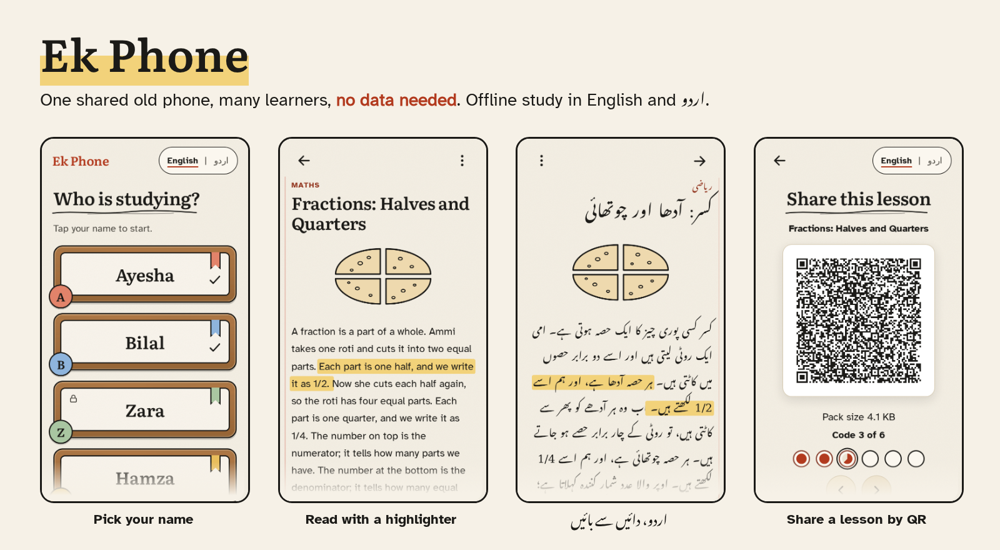
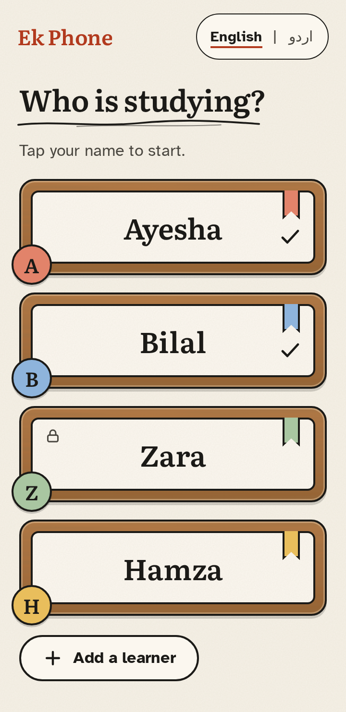
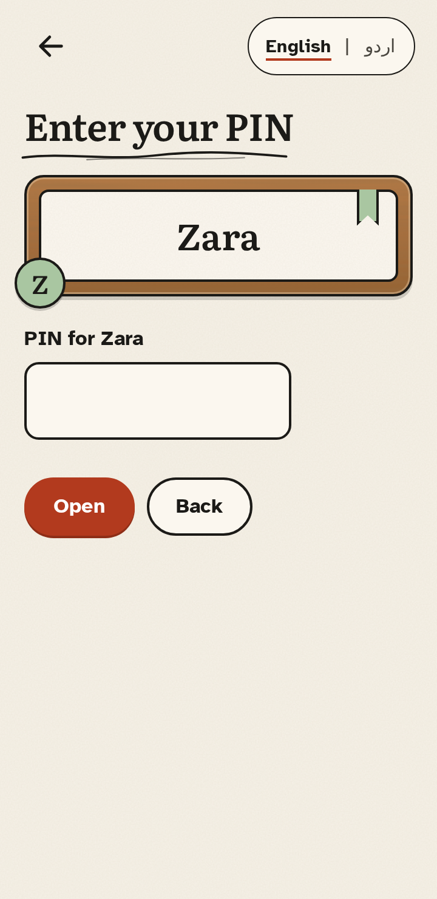
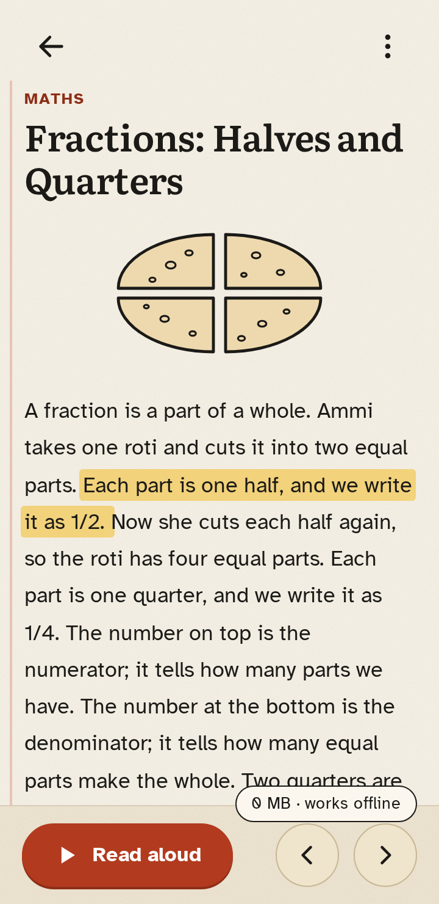
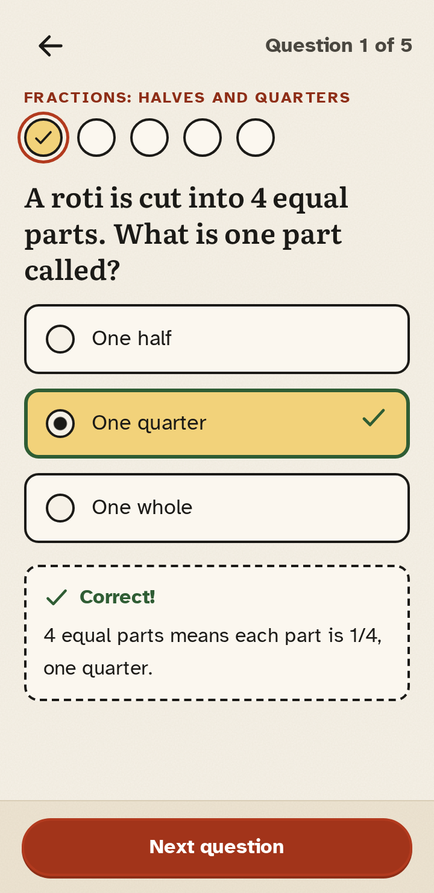
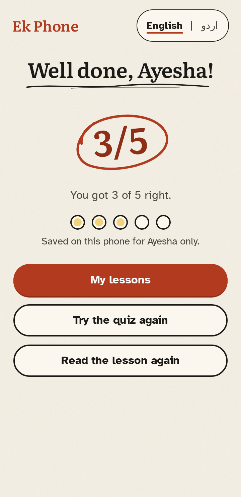
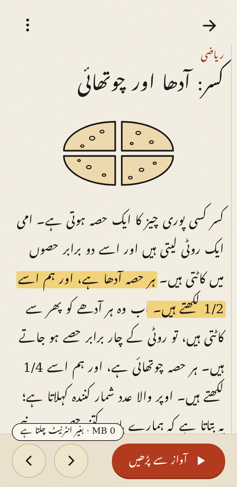
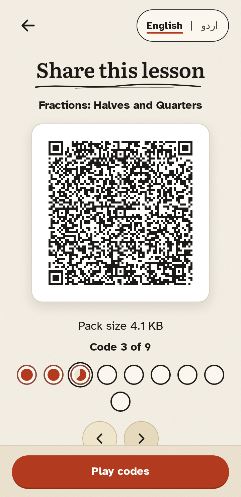
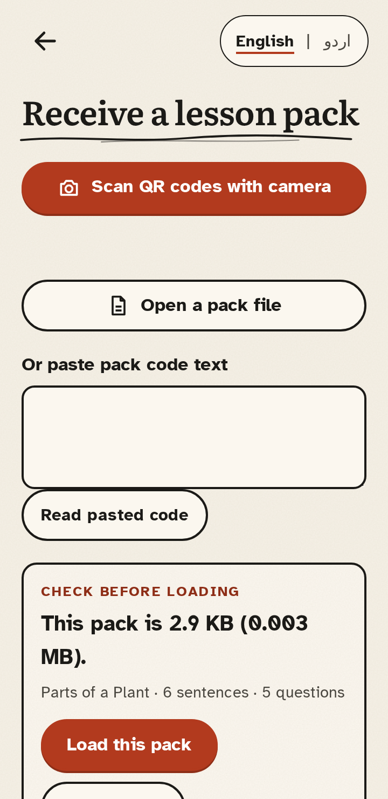
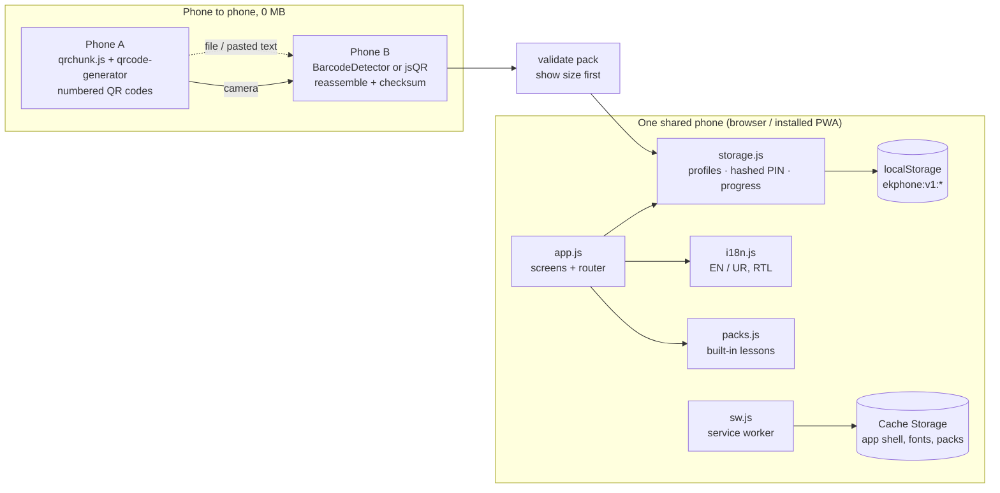

<p align="center"></p>

# Ek Phone

**One old Android phone, a few kids, no data bundle. Ek Phone lets each of them sign in, read a lesson, take a quiz and keep their own progress, fully offline, in English or Urdu.**

`offline-first PWA` · `0 MB to share a lesson` · `EN + اردو (RTL)` · `axe: 0 violations, 28 screens` · `Lighthouse A11y 100` · `no server, no accounts, no analytics` · `MIT`

> AccessED Hacks 2026, Connect door. Built during the event window (Oct 17 to Nov 20, 2026).
> Live demo: https://ekphone-app.vercel.app

---

## Who it's for

Siblings or classmates (three to five of them) who share **one** older Android phone, often a parent's, with little or no mobile data. Many education apps assume one child, one device, a login and a steady connection. Those assumptions shut this group out.

[FAIZI: one or two sentences in your own words on why this matters to you. Leave out anything you did not see yourself.]

## The barrier

| Assumption most study apps make | Reality for a shared old phone |
|---|---|
| Every learner has an account (email, OTP) | Kids share one phone and often have no email |
| Content streams from a server | The data bundle is small, expensive or empty |
| One person's progress per device | Four kids on one phone overwrite each other |
| English-only UI | Many learners read Urdu more easily |
| New content needs a download | Data costs money, so lessons rarely get updated |

## Before → After (one concrete example)

**Four siblings, one phone, no data bundle.**

- **Before:** each child needs their own account and a connection to log in. The app won't open offline. A new lesson means spending data. Progress mixes together on the one device.
- **After:** open Ek Phone, tap your name (with an optional 4-digit PIN), read today's lesson with a highlighter you can move, take a 5-question quiz, and your score is saved under *your* name. A classmate's phone shows a new lesson as a sequence of QR codes, and your phone scans it in, **using 0 MB of data**. The pack size is shown before you load it.

---

## Try it in 60 seconds

**Online:** open https://ekphone-app.vercel.app in Chrome on Android (or any modern browser). On a phone, use *Add to Home screen* to install it.

**Locally:**

```bash
git clone https://github.com/MuhammadFaizan-prog/ekphone.git
cd ekphone
npx serve app        # then open the URL it prints, e.g. http://localhost:3000
```

There is no build step needed to run it. `tools/build.mjs` only regenerates `js/packs.js`, `sw.js` and the size report.

**Test offline**
1. Open the app once while online. The service worker caches the app shell, fonts and built-in packs.
2. Turn on airplane mode, or in DevTools use *Network → Offline*.
3. Reload. Add a learner, read a lesson, finish the quiz. Everything works and progress is saved.

**Test QR sharing (two phones or two tabs)**
1. On phone/tab A: *Teacher or older sibling* → *Lesson packs* → **Show QR codes** on a lesson. It cycles through numbered codes ("Code 3 of 6").
2. On phone/tab B: **Receive a lesson pack** → **Scan QR codes with camera**, and point the camera at A. Codes can arrive in any order, and duplicates are ignored.
3. B shows the pack's title and size before you load it. With no camera, use **Open a pack file** (A can use **Send as file** over Bluetooth or any share app) or paste the pack text instead.

---

## Features

| | | | |
|:-:|:-:|:-:|:-:|
|  |  |  |  |
| **Local profiles**: up to 8 learners, each a name tag. No email, no account. | **Optional PIN**: 4 digits, stored only as a salted hash. 30 s lockout after 5 wrong tries. | **Highlighter reader**: arrow keys move the band sentence by sentence. Read-aloud highlights the sentence being spoken. | **5-question quiz**: feedback on each answer, best score kept per child. |
|  |  |  |  |
| **Per-child progress**: who read what and their best score. Removing a child removes their data. | **English / اردو toggle**: full RTL layout. The Nastaliq font loads only when Urdu is turned on. | **Share by chunked QR**: a lesson moves phone to phone with no data. Also works by file or pasted text. | **Size before loading**: every pack shows KB/MB first and is validated before it is saved. |

More screens, in both languages: [`screenshots/`](screenshots/).

**Built-in lesson packs** (self-written, synthetic content, CC BY 4.0): Grade 5 *Fractions: Halves and Quarters*, Grade 5 *Water Cycle*, Grade 4 *English Sentences*. Also a sample Grade 3 *Plant Parts* pack ([`app/samples/`](app/samples/)) for testing sharing.

---

## Accessibility & testing evidence

Every number below comes from a test that wrote its own result file. Nothing here is a manual claim.

| What | Result | Evidence |
|---|---|---|
| Unit tests (profiles, PIN hash + lockout, progress, pack validation, QR chunking, i18n parity) | **11 / 11 pass** | [`evidence/unit-tests.txt`](evidence/unit-tests.txt) |
| End-to-end flow: add learners, PIN gate, arrow-key reading, read-aloud sync, quiz, progress, Urdu RTL | **33 / 33 steps** | [`evidence/e2e-flow.json`](evidence/e2e-flow.json) |
| Offline: airplane mode, reload, finish lesson + quiz, Urdu font, QR screen, real Urdu-font size on button | **11 / 11 steps** | [`evidence/e2e-offline.json`](evidence/e2e-offline.json) |
| QR transfer between two browser contexts (fake camera feed) → byte-identical pack | **11 / 11 steps** | [`evidence/e2e-qr-transfer.json`](evidence/e2e-qr-transfer.json) |
| Keyboard-only walkthrough (no mouse/touch), visible focus ring at every stop | **37 / 37 steps** | [`evidence/keyboard-walkthrough.md`](evidence/keyboard-walkthrough.md) · [json](evidence/keyboard-walkthrough.json) |
| axe-core scan, every screen, English | **0 violations, 14 screens** | [`evidence/axe-en.json`](evidence/axe-en.json) |
| axe-core scan, every screen, Urdu (RTL) | **0 violations, 14 screens** | [`evidence/axe-ur-0-7.json`](evidence/axe-ur-0-7.json) · [`evidence/axe-ur-6-14.json`](evidence/axe-ur-6-14.json) |
| Lighthouse 11.7.1, mobile 360×740, simulated Regular 3G + 4× CPU slowdown | **Perf 80 · A11y 100 · Best practices 100 · PWA 100** | [`evidence/lighthouse-summary.md`](evidence/lighthouse-summary.md) · [json](evidence/lighthouse.json) |
| Byte budget: first-screen code ≤ 150 KB | **102.7 KB** (31.1 KB gzip). Everything incl. fonts, icons, lazy parts: **443.2 KB** | [`evidence/size-report.md`](evidence/size-report.md) |

Design choices for inclusion: Atkinson Hyperlegible body text (made for low-vision readers), large touch targets, high-contrast "Kaghaz" palette (ink `#1B1A17` on paper `#F6F1E7`, rust `#B23A1E`, highlighter `#F2D27A`), a skip link, a live region that announces the current sentence, `aria-invalid` with error text on forms, reduced-motion respected, and full RTL with Noto Nastaliq Urdu.

**How to re-run the tests:** `cd tools && npm ci`, then from the repo root: `node --test tests/unit.test.cjs`, `node tests/e2e/flow.mjs` (and `offline.mjs`, `qr-transfer.mjs`, `keyboard.mjs`, `screens.mjs en|ur`), `node tools/lighthouse.mjs`. The e2e tests need a Chromium headless shell. See `tools/pw.mjs`.

**What the testing does *not* show.** It was all automated on a cloud sandbox, not on a real low-end phone. Read-aloud was tested with a fake speech engine, so real device voices (especially Urdu) are **untested**. QR transfer used a fake camera feed, not two physical cameras. [FAIZI: add any real-device or real-user check you did yourself, with the date and phone model, or leave this out.]

---

## How it works



- **No backend.** The app is static files. After the first visit, the service worker serves everything from cache.
- **Lesson packs** are small JSON files (`ekphone-pack/1`): a bilingual title, sentences and 5 questions. The built-in ones are about 4 KB each as minified JSON.
- **QR sharing:** the pack is serialised, compressed with `deflate-raw` when the browser has `CompressionStream`, split into numbered chunks with a checksum, and shown as a cycling QR sequence. The receiver accepts chunks in any order, drops duplicates, rejects chunks from a different pack, and checks the reassembled pack before saving it.
- **Lazy loading:** the QR encoder loads only on the share screen. The jsQR scanner loads only if the phone has no native `BarcodeDetector`. The Urdu font (98.2 KB) loads only when Urdu is turned on.

## Data handling (summary)

Everything stays on the device: no server, no accounts, no analytics, no third-party requests. Profiles, progress and imported packs live in `localStorage`. PINs are never stored in plain text; each is hashed with SHA-256 and a random per-learner salt. The camera is used only while scanning, and frames are never stored or sent. Removing a learner deletes their progress. Full details: [`DATA-HANDLING.md`](DATA-HANDLING.md).

## Limitations (honest)

- **Not tested on a real low-end phone or with real learners.** All evidence comes from automated tests on a cloud sandbox.
- **Read-aloud depends on the phone's built-in voices.** Many phones have no Urdu voice. Tested only with a fake speech engine.
- **The PIN is a light privacy screen between siblings, not security.** A 4-digit PIN can be brute-forced by anyone with the device and DevTools. Lockout is per profile, stored locally.
- **localStorage can be wiped** if the user clears browser data, and there is no backup or sync.
- **Performance 80 on Lighthouse** (simulated 3G + slow CPU). It is held back by the single render-blocking stylesheet. LCP 4.6 s, FCP 2.4 s.
- **Only 3 built-in packs + 1 sample.** No authoring tool yet; packs are written as JSON by hand.
- **The QR sequence takes several codes per pack**, so a shaky hand or a dim screen slows it down. File and paste are the fallback.
- The Urdu font is a **subset** of Noto Nastaliq Urdu, so rare characters may fall back to a system font.

## Built during the event vs pre-existing

| Part | When |
|---|---|
| All app code (`app/js/*`, `app/css/*`, `index.html`, `sw.js`, manifest), lesson packs, icons, tests, tools, evidence, docs | **Built during the event window, on Nov 11, 2026** (see commit history, first commit `c3b523b`) |
| qrcode-generator 2.0.4, jsQR 1.4.0 (vendored) | Pre-existing open-source libraries |
| Atkinson Hyperlegible, Literata, Noto Nastaliq Urdu (subset) | Pre-existing open fonts (SIL OFL 1.1) |
| Dev-only tools: Playwright, axe-core, Lighthouse, esbuild, @fontsource packages | Pre-existing open-source tooling, not shipped in the app |

Nothing else existed before the event.

## Credits & licenses

Full list in [`CREDITS.md`](CREDITS.md).

- **qrcode-generator** 2.0.4, © 2009 Kazuhiko Arase, MIT. [`app/vendor/LICENSE-qrcode-generator.txt`](app/vendor/LICENSE-qrcode-generator.txt)
- **jsQR** 1.4.0, © Cosmo Wolfe, Apache-2.0. [`app/vendor/LICENSE-jsQR.txt`](app/vendor/LICENSE-jsQR.txt)
- **pdf.js** (pdfjs-dist) 3.11.174, © Mozilla Foundation, Apache-2.0. [`app/vendor/LICENSE-pdfjs.txt`](app/vendor/LICENSE-pdfjs.txt). Lazy-loaded only for PDF lesson import.
- **Fonts** (SIL Open Font License 1.1): Atkinson Hyperlegible (Braille Institute), Literata (TypeTogether for Google), Noto Nastaliq Urdu (Google). Licenses in [`app/fonts/`](app/fonts/).
- **Illustrations and icons:** drawn in code for this project (`app/js/art.js`, `app/icons/icon.svg`).
- **Datasets:** none. All lesson text, names and test learners are synthetic. No real student data was used.

## AI assistance disclosure

Hark AI assistant helped design, code, test and document this project; reviewed by the entrant, Muhammad Faizan.

## License

- **Code:** MIT. See [`LICENSE`](LICENSE). © 2026 Muhammad Faizan.
- **Lesson content** (`app/packs/*`, `app/samples/*`, self-written): **CC BY 4.0**.
- **Vendored libraries and fonts** keep their own licenses (MIT, Apache-2.0, SIL OFL 1.1), as listed above.

More: [`PLAN.md`](PLAN.md) · [`TRACKER.md`](TRACKER.md) · [`devpost-story.md`](devpost-story.md)
