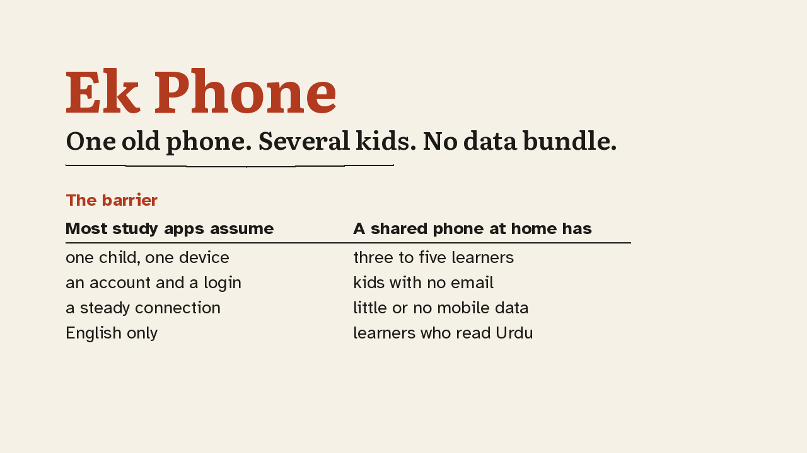
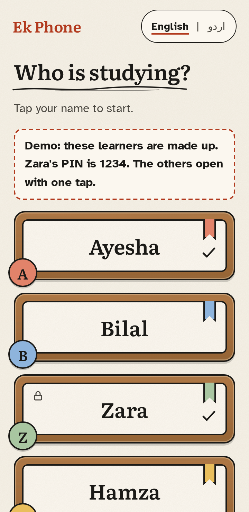
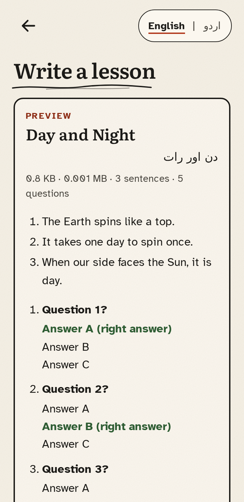
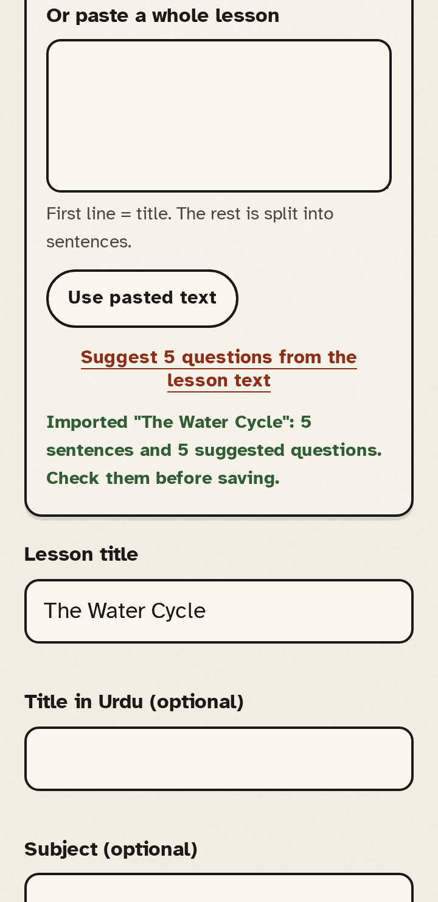
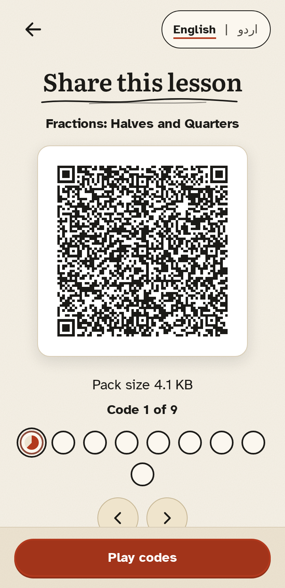
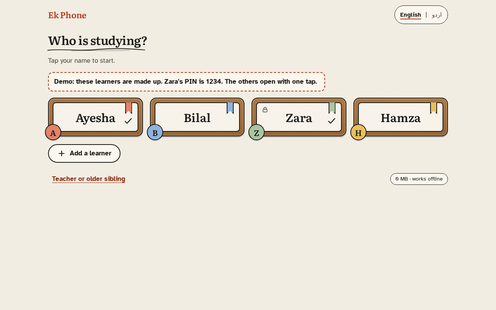
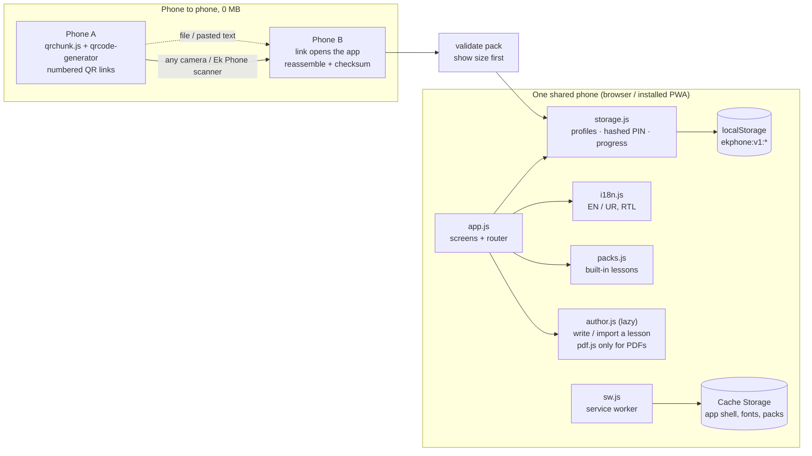

<p align="center"></p>

# Ek Phone

**Several kids, one old Android phone, no data bundle. Ek Phone gives each child their own name tag, lessons, quiz and progress on that one phone, fully offline, in English or Urdu.**

`several learners, one phone` · `offline-first PWA` · `0 MB to share a lesson` · `EN + اردو (RTL)` · `axe: 0 violations, 40 screens` · `Lighthouse A11y 100` · `no server, no accounts, no analytics` · `MIT`

> AccessED Hacks 2026, Connect door. Built during the event window (Oct 17 to Nov 20, 2026).
> Live demo: https://ekphone-app.vercel.app · Code (public, MIT): https://github.com/MuhammadFaizan-prog/ekphone · Demo video: [`docs/demo.mp4`](docs/demo.mp4)

> ### For judges: 60-second path
> 1. Open **https://ekphone-app.vercel.app** (phone or desktop).
> 2. Tap **Try the demo**. Four made-up learners appear.
> 3. **Pick a learner.** Ayesha opens with one tap; Zara uses the demo PIN **1234**.
> 4. **Read:** tap *Start reading*. The yellow highlighter moves sentence by sentence with the arrow keys or the arrow buttons.
> 5. **Quiz:** *Start practice*, 5 questions, feedback on every answer. The score is kept for that child only.
> 6. **Urdu:** tap **اردو** at the top. The whole app switches to Urdu, right to left.
> 7. **Teacher:** *Switch learner* → *Teacher or older sibling* → **Write a lesson**. Type one, or **import** a .txt, .md or .pdf file. 5 fill-in-the-blank questions are suggested for you to check.
> 8. **Share by QR:** *Lesson packs* → **Show QR codes**. Each code is a link into the app, so any phone camera can open it. No data needed.

---

## Who it's for: several children, one phone

Siblings or classmates (three to five of them) who share **one** older Android phone, often a parent's, with little or no mobile data. Many education apps assume one child, one device, a login and a steady connection. Those assumptions shut this group out. In Ek Phone the first screen asks **"Who is studying?"**: each child taps their own name tag (optional 4-digit PIN), and their reading, quiz scores and progress stay separate from everyone else's on the same phone.

## The barrier

| Assumption most study apps make | Reality for a shared old phone |
|---|---|
| One learner per device | Three to five kids share one phone and overwrite each other's progress |
| Every learner has an account (email, OTP) | Kids often have no email |
| Content streams from a server | The data bundle is small, expensive or empty |
| English-only UI | Many learners read Urdu more easily |
| New content needs a download | Data costs money, so lessons rarely get updated |

## Before → After (one concrete example)

**Four siblings, one phone, no data bundle.**

- **Before:** each child needs their own account and a connection to log in. The app won't open offline. A new lesson means spending data. Progress mixes together on the one device.
- **After:** open Ek Phone, tap your name (optional PIN), read today's lesson with a highlighter you can move, take a 5-question quiz, and your score is saved under *your* name. A teacher turns a text file into a lesson with suggested questions. A classmate's phone shows it as QR codes and your phone takes it in, **using 0 MB of data**, with the pack size shown before you load it.

---

## Demo video

[](docs/demo.mp4)

[`docs/demo.mp4`](docs/demo.mp4) · 2 min 38 s · 1280x720 · 1.8 MB · captions burned in, also as [`docs/demo.srt`](docs/demo.srt) and [`docs/demo.vtt`](docs/demo.vtt) · full transcript: [`docs/demo-transcript.md`](docs/demo-transcript.md).

It shows: the barrier → Try the demo → pick a learner + PIN 1234 → reading with the highlighter and arrow keys → quiz with feedback → per-child progress → Urdu RTL → a teacher imports a lesson from a .txt and edits the suggested questions → share by QR → a second browser context receives it with the size shown → network off, reload, still works → credits and limitations. Every phone image is a real screenshot of the app (360x640 Chromium viewport, synthetic learners). There is no voice-over; "offline" in the video is the browser's offline mode.

---

## Try it locally

```bash
git clone https://github.com/MuhammadFaizan-prog/ekphone.git
cd ekphone
npx serve app        # then open the URL it prints, e.g. http://localhost:3000
```

There is no build step needed to run it. `tools/build.mjs` only regenerates `js/packs.js`, `sw.js` and the size report.

**Test offline**
1. Open the app once while online. The service worker caches the app shell, fonts and built-in packs.
2. Turn on airplane mode, or in DevTools use *Network → Offline*.
3. Reload. Add a learner, read a lesson, finish the quiz. Progress is saved.

**Test QR sharing (two phones or two tabs)**
1. On phone/tab A: *Teacher or older sibling* → *Lesson packs* → **Show QR codes** on a lesson. It cycles through numbered codes ("Code 1 of 3").
2. On phone/tab B: point **any camera app** at the codes and open each link, or use Ek Phone's **Receive a lesson pack** → **Scan QR codes with camera**. Codes can arrive in any order, and duplicates are ignored.
3. B shows the pack's title and size before you load it. With no camera, use **Send as file** on A (Bluetooth or any share app; it saves a file if the phone has no share sheet) and **Open a pack file** on B, or paste the codes.

---

## Features

| | | | |
|:-:|:-:|:-:|:-:|
|  |  |  |  |
| **Local profiles**: up to 8 learners, each a name tag. No email, no account. | **Optional PIN**: 4 digits, stored only as a salted hash. 30 s lockout after 5 wrong tries. | **Highlighter reader**: arrow keys move the band sentence by sentence. Read-aloud highlights the sentence being spoken. | **5-question quiz**: feedback on each answer, best score kept per child. |
|  |  |  |  |
| **Per-child progress**: who read what and their best score. Removing a child removes their data. | **English / اردو toggle**: full RTL layout. The Nastaliq font loads only when Urdu is turned on. | **Share by chunked QR**: a lesson moves phone to phone with no data. Also works by file or pasted text. | **Size before loading**: every pack shows KB/MB first and is validated before it is saved. |

### New in this round

| | | | |
|:-:|:-:|:-:|:-:|
|  |  |  |  |
| **One-tap demo**: 4 synthetic learners with some progress; Zara's PIN 1234 is shown on screen. *Reset demo* restores it. | **Teacher lesson writer**: title, text split into sentences live, 5 questions, error summary, preview with size, saved as a local pack. | **Import from .txt, .md or .pdf**: title from the first line, sentences split, 5 fill-in-the-blank questions suggested and editable. pdf.js loads only for a PDF. | **QR codes are app links**: each code opens Ek Phone in any camera app (longest link 296 characters). Pieces are kept until the pack is complete. |

<p align="center"></p>
<p align="center"><em>Desktop, 1280 px wide (responsive layout). Also: <a href="screenshots/wide-1280-en-17-import.png">import at 1280 px</a>.</em></p>

Also new: **offline Send as file** with a download fallback when the phone has no share sheet, and **camera errors with Try again** (permission off, no camera, camera busy, and a retry with any camera). More screens, in both languages and at 768/1280 px: [`screenshots/`](screenshots/).

**Built-in lesson packs** (self-written, synthetic content, CC BY 4.0): Grade 5 *Fractions: Halves and Quarters*, Grade 5 *Water Cycle*, Grade 4 *English Sentences*. Also a sample Grade 3 *Plant Parts* pack ([`app/samples/`](app/samples/)) for testing sharing.

---

## Rubric map

| Criterion | Where the evidence is |
|---|---|
| **Barrier Removed** | [Who it's for](#who-its-for-several-children-one-phone) · [The barrier](#the-barrier) · [Before → After](#before--after-one-concrete-example) · offline run with 0 app network requests ([`evidence/e2e-offline.json`](evidence/e2e-offline.json)) · QR sharing with 0 server bytes ([`evidence/e2e-qr-transfer.json`](evidence/e2e-qr-transfer.json)) |
| **Learning Value** | Highlighter reader, 5-question quiz with feedback, per-child best scores ([`evidence/e2e-flow.json`](evidence/e2e-flow.json)) · teacher lesson writer ([`evidence/e2e-demo-author.json`](evidence/e2e-demo-author.json)) · import with 5 suggested questions ([`evidence/e2e-import-lesson.json`](evidence/e2e-import-lesson.json)) |
| **Inclusive Experience** | axe 0 violations on 20 EN + 20 UR screens ([`evidence/axe-en.json`](evidence/axe-en.json)) · keyboard-only 73/73 ([`evidence/keyboard-walkthrough.md`](evidence/keyboard-walkthrough.md)) · responsive 0 sideways scroll in 242 checks ([`evidence/responsive.json`](evidence/responsive.json)) · Urdu RTL · Lighthouse A11y 100 |
| **Working Prototype & Explanation** | Live site ([check, 14/14](evidence/live-check.json)) · [60-second path](#for-judges-60-second-path) · [demo video](docs/demo.mp4) + [transcript](docs/demo-transcript.md) · [Real-device check](#real-device-check) · [How it works](#how-it-works) · [Limitations](#limitations-honest) |

---

## Accessibility & testing evidence

Every number below comes from a test that wrote its own result file. Nothing here is a manual claim.

| What | Result | Evidence |
|---|---|---|
| Unit tests (profiles, PIN hash + lockout, progress, pack validation, QR chunking, i18n parity) | **16 / 16 pass** | [`evidence/unit-tests.txt`](evidence/unit-tests.txt) |
| End-to-end flow: add learners, PIN gate, arrow-key reading, read-aloud sync (fake engine), quiz, per-child progress, Urdu RTL | **33 / 33 steps** | [`evidence/e2e-flow.json`](evidence/e2e-flow.json) |
| One-tap demo + teacher lesson writer + print / save as page | **30 / 30 steps** | [`evidence/e2e-demo-author.json`](evidence/e2e-demo-author.json) |
| Offline: reload, lesson + quiz, Urdu font, QR screen, lesson writer, demo | **14 / 14 steps**, **0 app requests** reached the network (26 answered by the service worker; Chromium's own `sw.js` update check recorded separately: 1) | [`evidence/e2e-offline.json`](evidence/e2e-offline.json) |
| QR transfer between two browser contexts (fake camera feed) | **13 / 13 steps**, **7 codes in 3.9 s**, 0 server bytes | [`evidence/e2e-qr-transfer.json`](evidence/e2e-qr-transfer.json) |
| Fixes for the phone bugs: offline send-as-file, QR codes as app links, camera errors + retry | **23 / 23 steps** | [`evidence/e2e-share-camera.json`](evidence/e2e-share-camera.json) |
| Import from .txt, .md, .pdf, scanned PDF, pasted text, offline PDF | **17 / 17 steps** | [`evidence/e2e-import-lesson.json`](evidence/e2e-import-lesson.json) |
| Keyboard-only walkthrough (no mouse/touch), visible focus ring at every stop | **73 / 73 steps** (149 key presses) | [`evidence/keyboard-walkthrough.md`](evidence/keyboard-walkthrough.md) · [json](evidence/keyboard-walkthrough.json) |
| axe-core 4.14.0 scan of every screen | **0 violations on 20 English + 20 Urdu (RTL) screens** | [`evidence/axe-en.json`](evidence/axe-en.json) · Urdu: [`0-6`](evidence/axe-ur-0-6.json) · [`6-14`](evidence/axe-ur-6-14.json) · [`14-20`](evidence/axe-ur-14-20.json) |
| Responsive: 11 screens × 11 views (320, 360, 414 px, 740×360 landscape, 768, 1024, 1280, 1920 px, 200% and 400% zoom, 160% text) | **0 sideways scroll in 121 EN + 121 UR checks** | [`evidence/responsive.json`](evidence/responsive.json) |
| Live site https://ekphone-app.vercel.app (same build id as the repo, demo, PIN, quiz, QR links, offline, axe on 9 screens) | **14 / 14 steps** | [`evidence/live-check.json`](evidence/live-check.json) |
| Lighthouse 11.7.1, mobile 360×740, simulated Regular 3G + 4× CPU slowdown | **Perf 91** (median of 3) · **A11y 100** · **Best practices 100** · **PWA 100** · LCP 3.2 s · FCP 2.1 s | [`evidence/lighthouse-summary.md`](evidence/lighthouse-summary.md) · [json](evidence/lighthouse.json) |
| Byte budget: first-screen code ≤ 150 KB | **127.3 KB** (37.5 KB gzip). Everything incl. fonts, icons and lazy parts: **1895.6 KB**, of which pdf.js is 1374.2 KB, loaded only when a PDF is imported | [`evidence/size-report.md`](evidence/size-report.md) |

### Before → after numbers

From [`evidence/measurements.md`](evidence/measurements.md). Before = commit `f4e2acd` (Nov 11, before this round of work).

| Metric | Before | After |
|---|---|---|
| Lighthouse Performance, same gzip test server and settings for both (median of 3) | 85 (FCP 2.4 s, LCP 3.8 s) | **91** (FCP 2.1 s, LCP 3.2 s) |
| Lighthouse Accessibility | 100 | 100 |
| First-screen code (HTML + CSS + own JS) | 102.7 KB (31.1 KB gzip) | 127.3 KB (37.5 KB gzip), within the 150 KB budget; now includes the demo and print code |
| QR transfer of the sample pack (camera scan to preview) | 4 codes, time not measured | 7 codes in 3.9 s (fake camera feed) |
| Lesson data sent over the network to share a pack by QR | not measured | 0 bytes (0 server requests during the scan) |
| App requests that reached the network during the offline run | not measured | 0 (26 answered from the service worker cache) |
| QR codes per built-in pack | not measured | 9 codes for 4.1 KB (fractions) · 10 for 4.2 KB (water cycle) · 9 for 3.8 KB (English sentences) |

Design choices for inclusion: Atkinson Hyperlegible body text (made for low-vision readers), large touch targets, high-contrast "Kaghaz" palette (ink `#1B1A17` on paper `#F6F1E7`, rust `#B23A1E`, highlighter `#F2D27A`), a skip link, a live region that announces the current sentence, `aria-invalid` with error text on forms, reduced-motion respected, and full RTL with Noto Nastaliq Urdu.

**How to re-run the tests:** `cd tools && npm ci`, then from the repo root: `node --test tests/unit.test.cjs`, `node tests/e2e/flow.mjs` (and `offline.mjs`, `qr-transfer.mjs`, `demo-author.mjs`, `import-lesson.mjs`, `share-camera.mjs`, `keyboard.mjs`, `screens.mjs en|ur`, `responsive.mjs en|ur`), `node tests/live-check.mjs`, `node tools/lighthouse.mjs`. The browser tests need a Chromium headless shell; see `tools/pw.mjs`. The demo video is rebuilt with `node tools/demo-capture.mjs <dir>` then `python3 tools/demo-video.py <dir> <out>`.

---

## Real-device check

On **2026-11-11** the entrant installed the PWA on **his own Android phone** and the offline core worked. He found 4 bugs:

1. **Send as file** did not work offline.
2. The phone camera read the QR codes as **a random string**.
3. There was **no import from a file**.
4. There was **no responsive layout**.

All four are fixed in commit `fc45750`: offline Send as file with a download fallback, QR codes that are links into the app, import from .txt/.md/.pdf, and a responsive layout from 320 to 1920 px. The fixes are covered by the automated tests above (23/23, 17/17, and 0 sideways scroll in 242 responsive checks).

**Not yet tested:** read-aloud with real phone voices (especially Urdu), TalkBack, and QR transfer between two physical cameras.

---

## How it works



- **No backend.** The app is static files. After the first visit, the service worker serves everything from cache.
- **Lesson packs** are small JSON files (`ekphone-pack/1`): a bilingual title, sentences and 5 questions. The built-in ones are about 4 KB each as minified JSON.
- **QR sharing:** the pack is serialised, compressed with `deflate-raw` when the browser has `CompressionStream`, split into numbered chunks with a checksum, and shown as a cycling sequence of QR codes. Each code is a link into the app (`#/r/<pack>/<i>/<n>/<data>`, at most 300 characters), so any camera app can open it; Ek Phone's own scanner (native `BarcodeDetector`, or jsQR as a fallback) reads the same codes. The receiver accepts pieces in any order, drops duplicates, rejects pieces from a different pack, and checks the reassembled pack before saving it.
- **Lesson writer and import:** the writer splits text into sentences as you type and validates every field. Import takes .txt, .md (Markdown removed) or .pdf (text read by pdf.js), uses the first line as the title, and suggests 5 fill-in-the-blank questions that the teacher checks and edits before saving. A scanned, picture-only PDF gets a clear "no text found" message.
- **Lazy loading:** the QR encoder loads only on the share screen, the writer only on its screen, pdf.js (1374.2 KB) only when a PDF is picked, and jsQR only if the phone has no native `BarcodeDetector`. The Urdu font (98.2 KB) loads only when Urdu is turned on. Each is cached for offline use after first use.

## Data handling (summary)

Everything stays on the device: no server, no accounts, no analytics, no third-party requests. Profiles, progress and imported packs live in `localStorage`. PINs are never stored in plain text; each is hashed with SHA-256 and a random per-learner salt. The camera is used only while scanning, and frames are never stored or sent. Removing a learner deletes their progress. Full details: [`DATA-HANDLING.md`](DATA-HANDLING.md).

## Limitations (honest)

- **Real-device testing so far is one check** on the entrant's own Android phone (see above). No testing with real learners yet.
- **Read-aloud depends on the phone's built-in voices.** Many phones have no Urdu voice. Automated tests used a fake speech engine.
- **TalkBack and QR transfer between two physical cameras are untested.** The automated QR test used a fake camera feed.
- **The PIN is a light privacy screen between siblings, not security.** A 4-digit PIN can be brute-forced by anyone with the device and DevTools. Lockout is per profile, stored locally.
- **localStorage can be wiped** if the user clears browser data, and there is no backup or sync.
- **Suggested questions are simple fill-in-the-blanks** built from the lesson's own words. The teacher has to check them before saving.
- **Only 3 built-in packs + 1 sample.** More lessons come from the writer, import or sharing.
- **The QR sequence takes several codes per pack** (9 to 10 for the built-in packs), so a shaky hand or a dim screen slows it down. File and paste are the fallback.
- The Urdu font is a **subset** of Noto Nastaliq Urdu, so rare characters may fall back to a system font.

## Built during the event vs pre-existing

| Part | When |
|---|---|
| All app code (`app/js/*`, `app/css/*`, `index.html`, `sw.js`, manifest), lesson packs, icons, tests, tools, evidence, docs, demo video | **Built during the event window, on Nov 11, 2026** (see commit history, first commit `c3b523b`) |
| qrcode-generator 2.0.4, jsQR 1.4.0, pdf.js 3.11.174 (vendored) | Pre-existing open-source libraries |
| Atkinson Hyperlegible, Literata, Noto Nastaliq Urdu (subset) | Pre-existing open fonts (SIL OFL 1.1) |
| Dev-only tools: Playwright, axe-core, Lighthouse, esbuild, @fontsource packages, ffmpeg, Pillow | Pre-existing open-source tooling, not shipped in the app |

Nothing else existed before the event.

## Credits & licenses

Full list in [`CREDITS.md`](CREDITS.md).

- **qrcode-generator** 2.0.4, © 2009 Kazuhiko Arase, MIT. [`app/vendor/LICENSE-qrcode-generator.txt`](app/vendor/LICENSE-qrcode-generator.txt)
- **jsQR** 1.4.0, © Cosmo Wolfe, Apache-2.0. [`app/vendor/LICENSE-jsQR.txt`](app/vendor/LICENSE-jsQR.txt)
- **pdf.js** (pdfjs-dist) 3.11.174, © Mozilla Foundation, Apache-2.0. [`app/vendor/LICENSE-pdfjs.txt`](app/vendor/LICENSE-pdfjs.txt). Lazy-loaded only for PDF lesson import.
- **Fonts** (SIL Open Font License 1.1): Atkinson Hyperlegible (Braille Institute), Literata (TypeTogether for Google), Noto Nastaliq Urdu (Google). Licenses in [`app/fonts/`](app/fonts/).
- **Illustrations and icons:** drawn in code for this project (`app/js/art.js`, `app/icons/icon.svg`).
- **Datasets:** none. All lesson text, names and test learners are synthetic. No real student data was used.

## AI assistance disclosure

Hark AI assistant helped design, code, test and document this project, and made the demo video; reviewed by the entrant, Muhammad Faizan.

## License

- **Code:** MIT. See [`LICENSE`](LICENSE). © 2026 Muhammad Faizan.
- **Lesson content** (`app/packs/*`, `app/samples/*`, self-written): **CC BY 4.0**.
- **Vendored libraries and fonts** keep their own licenses (MIT, Apache-2.0, SIL OFL 1.1), as listed above.

More: [`PLAN.md`](PLAN.md) · [`TRACKER.md`](TRACKER.md) · [`devpost-story.md`](devpost-story.md)
